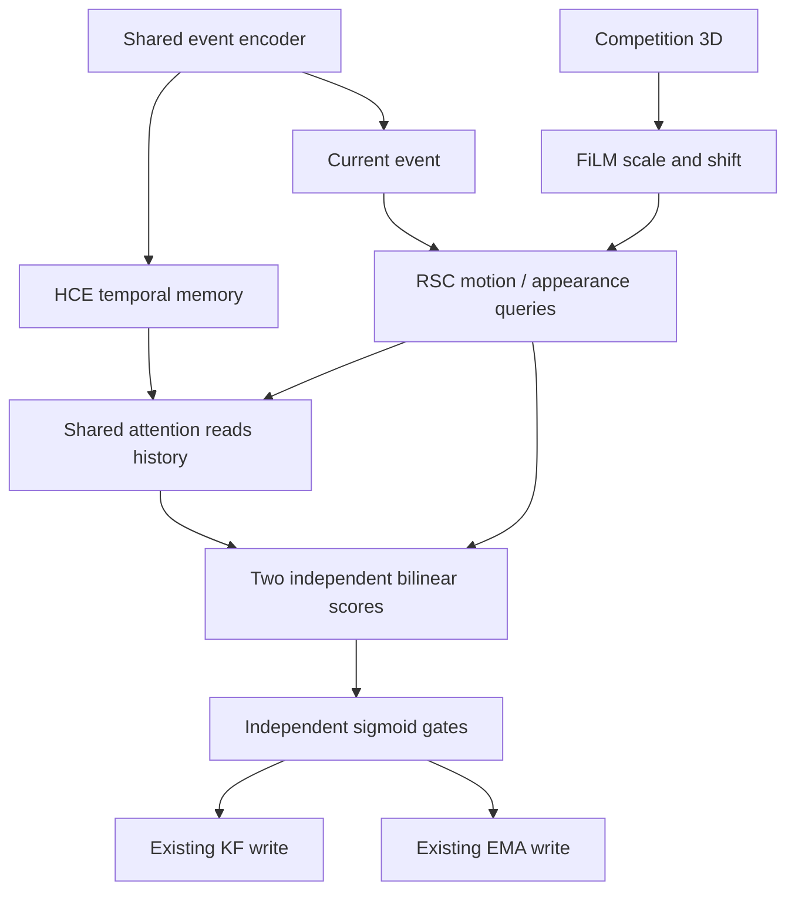

# SHUTrack query / FiLM / bilinear architecture

Branch: `feature/shutrack-query-film-bilinear`

This is an opt-in architecture change built on the existing optimized paired
training pipeline. No training run or tracking evaluation was launched for this
change. The existing data, losses, sample order, training budget, normalization,
KF update and appearance EMA update are reused.

## Information flow



History contains the five events strictly before the current event. The same
evidence encoder, appearance encoder and event fusion are applied to history
and current. HCE encodes all five positions plus an always-valid learned null
position. RSC constructs two current queries, HCE reads its memory with these
queries, then RSC scores each query and its own history readout.

Competition does not become a separate 128D event and is not concatenated with
the 128D current event. Its three already-normalized scalars pass through
3→32 and two 32→256 projections. Each projection produces per-channel scale
and shift for one 128D query:

`q = (1 + gamma) * LayerNorm(GELU(Linear(current))) + beta`

The final modulation projections start at zero, so the initial modulation is
exactly identity. Their gradients are active immediately; the earlier 3→32
condition encoder initially has zero gradients until the zero projections
start learning. There is no hard-coded rule that competition must suppress
writes.

The two branches share one attention reader, including a residual query,
LayerNorm, feed-forward block and second residual LayerNorm. Each score uses
independent parameters:

`logit = q_norm^T A h_norm / sqrt(128) + Linear(concat(q_norm, h_norm))`

The implementation uses matrix multiplication and reduction rather than
materializing per-sample 128×128 outer products. Independent sigmoids produce
motion and appearance gates. Neither future GT nor rank/column supervision is
an input at inference.

## Dimensions and parameters

Default comparison configuration: ReID input 2048, appearance projection 256,
d_model 128, four attention heads, two temporal layers, feed-forward width 256,
dropout 0.

| Part | Parameters |
| --- | ---: |
| Evidence encoder: 13→128→128 with normalization | 18,586 |
| Appearance encoder: shared 2048→256, four-way interaction 1024→128→128 | 673,280 |
| Shared event fusion: 256→128 + LayerNorm | 33,152 |
| HCE temporal memory (two layers + positions + null) | 265,856 |
| HCE shared attention reader + feed-forward block | 132,480 |
| RSC two base queries + normalization | 33,536 |
| RSC competition conditioning + two modulation projections | 17,024 |
| RSC two bilinear gate heads | 34,306 |
| **Total** | **1,208,220** |

D-256 baseline: 1,324,194 parameters. Difference: −115,974 (−8.76%).
Parameter count does not establish actual latency. Full training and tracking
speed for the new architecture remain unmeasured.

## Integration and compatibility

- `architecture_variant="legacy"` remains the default for existing configs.
  Checkpoints without that field load as the existing architecture, strictly.
- `architecture_variant="query_film_bilinear"` enables this model.
  In the paired trainer, its default appearance projection is 256; the legacy
  default stays 64. Explicit `--appearance-proj-dim 256` is recommended in runs.
- The new variant rejects `appearance_match_input=True`: the separate legacy
  cosine-column experiment is not part of this architecture.
- Model config records the variant. Resuming or initializing from a different
  variant is rejected. Existing D-256 weights cannot initialize the new
  architecture by ignoring missing keys; use from-scratch for the comparison.
- Old and new checkpoints use the normal runtime loader and unchanged tracker
  adapter. Inference selects the architecture from the checkpoint.
- Existing history padding/reset flags are honored. The null position prevents
  all-masked attention. Missing current detections supply no appearance content;
  the runtime retains its existing forced-zero applied-gate behavior.
- Feature schema and paired label schema are unchanged. No data regeneration.
- Optimized prefetch, mmap rank features, pinned transfers, compact ReID and
  deferred statistics are unchanged.

## Validation

- Final full suite: **157 passed, 2 skipped** (18 new architecture cases).
- Legacy seeded fixed-batch logits retain SHA-256
  `ede591e31190572231fd2dfa8b8cf7c9f38f5bb649b5c4aa04af1cc80d02c077`
  before and after this change.
- New tests cover dimensions/counts, independent gates, identity modulation,
  competition sensitivity after perturbation, masked/reset history, missing
  detections, current/history influence, bilinear algebra and gradients,
  strict checkpoints, weights-only compatibility, old resume config,
  existing tracker adapter, offline/online parity and causality.
- Real optimized D batches: MOT20-02 on CUDA and MOT20-03 on CPU, 126 examples
  each. Rank-valid: 84/75; column-valid: 42/42. DIoU, rank and column losses
  and every parameter gradient are finite; both bilinear heads and both FiLM
  projections receive nonzero gradients.
- New checkpoint roundtrip through `load_runtime_model`: maximum logit
  error 0.0 on both real batches. No optimizer updates.
- The existing target derivation emitted a NumPy exponential overflow warning
  on MOT20-03; the resulting targets, losses and gradients were finite.
  Target/loss formulas were not changed in this architecture patch.

Re-run the focused checks:

```bash
.venv/bin/python -c 'import torch,pytest; torch.set_num_threads(4); raise SystemExit(pytest.main(["-q","shutrack/tests"]))'
.venv/bin/python tools/verify_query_controller.py \
  --data-root outputs/agentguard/experiments/shutrack_bd_mot_20261120/MOT20/data \
  --reference-checkpoint outputs/agentguard/experiments/shutrack_d_proj256_mot20_20261120/groups/appearance_row_column/checkpoints/epoch_100.pt \
  --sequence MOT20-02 --device cuda
```

## Prepared comparison command — not executed

Same MOT20 train sequences and D loss settings as the accepted D-256 baseline.
Use a new output directory so the baseline remains available.

```bash
.venv/bin/python -u tools/train_supervision_groups.py \
  --dataset MOT20 --group appearance_row_column \
  --architecture-variant query_film_bilinear --appearance-proj-dim 256 \
  --data-root outputs/agentguard/experiments/shutrack_bd_mot_20261120/MOT20/data \
  --groups-root outputs/agentguard/experiments/shutrack_query_film_bilinear_mot20_20261120/groups \
  --split train --sequences MOT20-02 MOT20-03 \
  --from-scratch --device cuda --batch-size 1024 \
  --lr 1e-4 --weight-decay 1e-4 --seed 42 \
  --max-epochs 100 --snapshot-every 20 \
  --rank-weight 18 --rank-tau 0.1 --rank-alpha 0.95 --column-weight 50
```

This preserves four alternating data shards ×25 cycles =100 shard-epochs,
11,100 total steps and 111 warmup steps. Evaluation can then use the unchanged
tracker entry with the new checkpoint, on MOT20-01/MOT20-05 and the same
detection cache, NSA KF, seed 10000 and raw-result protocol as D-256.
